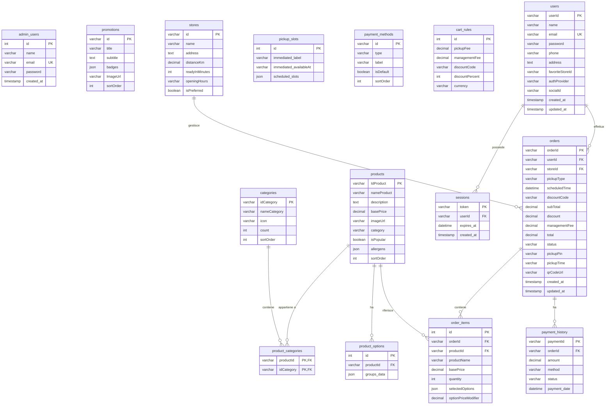

# Architettura Database AppFood

Questo documento descrive la struttura del database relazione `AppFood` (MySQL/MariaDB), inclusi i tipi di dati, le chiavi primarie, le chiavi esterne e il diagramma ERD (Entity-Relationship Diagram) generato con **Mermaid**.

---

## 📊 Diagramma Entity-Relationship (Mermaid)

---

## 📂 Struttura Dettagliata delle Tabelle

### 1. Amministrazione e Utenti
* **`admin_users`**: Account di amministrazione del sistema.
* **`users`**: Profilo dell'utente cliente, con supporto ad autenticazione locale e social.
* **`sessions`**: Gestione dei token di sessione per l'autenticazione degli utenti.

### 2. Catalogo Prodotti e Categorie
* **`categories`**: Categorie principali dei prodotti.
* **`products`**: Prodotti disponibili nell'applicazione.
* **`product_categories`**: Tabella di junction (molti-a-molti) tra prodotti e categorie.
* **`product_options`**: Varianti e personalizzazioni dei prodotti (es. ingredienti extra, formato) salvate in formato `JSON`.

### 3. Negozi e Promozioni
* **`stores`**: Punti vendita con orari di apertura e distanza.
* **`promotions`**: Banner promozionali in home page.
* **`pickup_slots`**: Slot temporali disponibili per il ritiro.

### 4. Ordini e Pagamenti
* **`orders`**: Testata dell'ordine contenente totali, stato, cliente e negozio di riferimento.
* **`order_items`**: Righe di dettaglio dell'ordine (quantità, prezzo unitario e opzioni selezionate).
* **`payment_history`**: Storico dei tentativi e delle transazioni di pagamento.
* **`payment_methods`**: Metodi di pagamento registrati.
* **`cart_rules`**: Regole del carrello (commissioni, codici sconto globali).

---

## 🔗 Regole di Integrità Referenziale (Foreign Keys)
* `product_categories` $\rightarrow$ `products` (`CASCADE` ON DELETE/UPDATE)
* `product_categories` $\rightarrow$ `categories` (`CASCADE` ON DELETE/UPDATE)
* `product_options` $\rightarrow$ `products` (`CASCADE` ON DELETE)
* `sessions` $\rightarrow$ `users` (`CASCADE` ON DELETE)
* `orders` $\rightarrow$ `users` (`SET NULL` ON DELETE)
* `orders` $\rightarrow$ `stores` (`SET NULL` ON DELETE)
* `order_items` $\rightarrow$ `orders` (`CASCADE` ON DELETE)
* `order_items` $\rightarrow$ `products` (`SET NULL` ON DELETE)
* `payment_history` $\rightarrow$ `orders` (`SET NULL` ON DELETE)